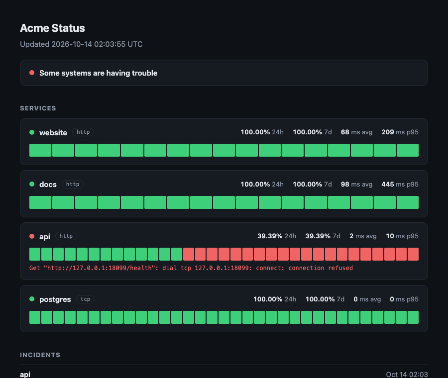

# pulso

[](https://github.com/KlGamers/pulso/actions/workflows/ci.yml)

Monitor de disponibilidad autohospedado que se distribuye como un solo binario.
Revisa servicios HTTP y TCP cada cierto tiempo, guarda el historial en SQLite,
avisa por webhook cuando algo se cae o se recupera y sirve una página de
estado.



## Por qué

Los monitores en la nube cobran por cada revisión y piden una cuenta por
persona del equipo. Los autohospedados suelen necesitar un servidor de base de
datos y una cola. pulso necesita un archivo JSON y un lugar donde escribir un
archivo SQLite.

## Inicio rápido

```sh
go install github.com/KlGamers/pulso/cmd/pulso@latest
cp pulso.example.json pulso.json
pulso -c pulso.json
```

Abre http://localhost:8080.

Con Docker:

```sh
docker build -t pulso .
docker run -p 8080:8080 -v "$PWD:/data" pulso
```

## Configuración

```json
{
  "listen": ":8080",
  "db": "pulso.db",
  "title": "Acme Status",
  "keep": "720h",
  "workers": 8,
  "alert": { "url": "https://hooks.example.com/pulso", "fail_after": 3, "recover_after": 2 },
  "targets": [
    { "name": "website", "addr": "https://example.com", "every": "30s" },
    { "name": "api", "addr": "https://api.example.com/health", "expect": 200, "match": "\"ok\"" },
    { "name": "postgres", "kind": "tcp", "addr": "db.internal:5432", "timeout": "3s" }
  ]
}
```

| Campo | Por defecto | Qué hace |
|---|---|---|
| `listen` | `:8080` | Dirección de la página de estado y la API |
| `db` | `pulso.db` | Archivo SQLite |
| `keep` | `720h` | Cuánto tiempo se conserva el historial |
| `workers` | `8` | Máximo de revisiones en paralelo |
| `alert.url` | ninguno | Webhook que recibe los cambios de estado |
| `alert.fail_after` | `3` | Fallos seguidos antes de marcar un servicio como caído |
| `alert.recover_after` | `2` | Éxitos seguidos antes de marcarlo como recuperado |
| `targets[].kind` | `http` | `http` o `tcp` |
| `targets[].every` | `30s` | Intervalo entre revisiones |
| `targets[].timeout` | `5s` | Tiempo límite de cada revisión. No puede superar `every` |
| `targets[].expect` | cualquier 2xx o 3xx | Código de estado exacto que se exige |
| `targets[].match` | ninguno | Texto que debe aparecer en la respuesta |

La configuración se valida al arrancar. Un archivo inválido detiene el proceso
indicando qué servicio tiene el problema.

## Alertas

Un servicio pasa a caído solo después de `fail_after` fallos seguidos, y vuelve
a estar arriba tras `recover_after` éxitos, así que un paquete perdido no
despierta a nadie. Cada cambio se notifica una vez:

```json
{ "kind": "down", "target": "api", "at": "2026-01-10T08:15:04Z", "reason": "status 502", "fails": 3 }
```

Los envíos fallidos se reintentan con espera exponencial. Los incidentes
abiertos sobreviven a un reinicio, así que un servicio que ya estaba caído no
se anuncia dos veces.

## API

| Ruta | Devuelve |
|---|---|
| `GET /api/targets` | Estado, última revisión, disponibilidad de 24 h y 7 días, latencia promedio y p95 |
| `GET /api/targets/{name}/checks?n=100` | Revisiones más recientes, de la más vieja a la más nueva |
| `GET /api/incidents` | Últimos 50 incidentes |
| `GET /healthz` | `ok` |

## Cómo funciona

```
cfg ──> sched ──> probe ──> store (SQLite, WAL)
          │                    ▲
          └──> alert ──> webhook
                               │
web  <─────────────────────────┘
```

- `sched` lanza una goroutine por servicio. Cada una espera un desfase fijo
  derivado del nombre del servicio y luego revisa a su propio ritmo. Un
  semáforo limita las revisiones simultáneas a `workers`.
- `probe` reutiliza un solo transporte HTTP, limita cada petición con un
  contexto con fecha límite y lee como máximo 1 MiB de respuesta. Un servicio
  atrapado en un ciclo de redirecciones se marca como caído después de cinco
  saltos.
- `alert` es una pequeña máquina de estados por servicio. Es el único lugar
  que decide si un resultado es un incidente.
- `store` usa el driver de SQLite escrito en Go puro, así que el binario no
  depende de C y se compila para otras plataformas con `CGO_ENABLED=0`.
- `web` genera una sola plantilla embebida y expone los mismos datos en JSON.

## Desarrollo

```sh
make test
make lint
make build
```

Las pruebas corren contra servidores `httptest` y bases de datos temporales.
Nada sale a la red. La cobertura es de 94% y el CI falla si baja de 90%.

## Límites

- Un proceso, un archivo SQLite. No hay clúster ni revisiones desde varias
  regiones.
- Las revisiones HTTP solo usan `GET`.
- La página de estado no tiene autenticación. Ponla detrás de tu proxy si no
  debe ser pública.

## Licencia

MIT
